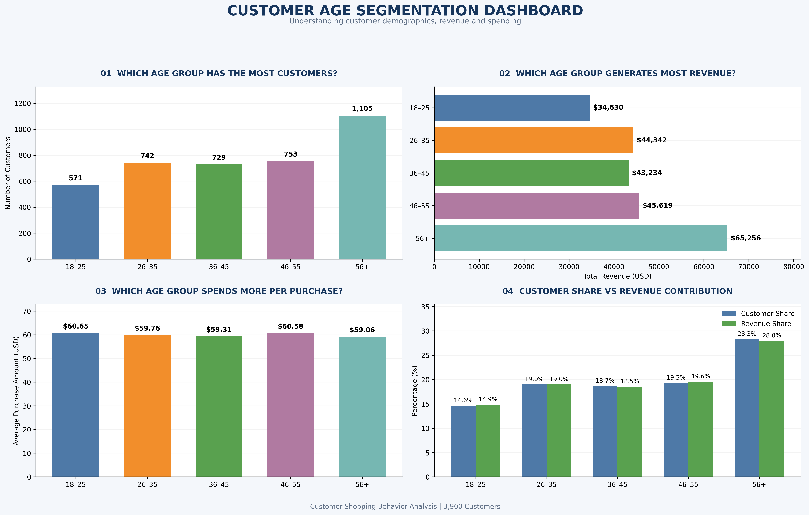
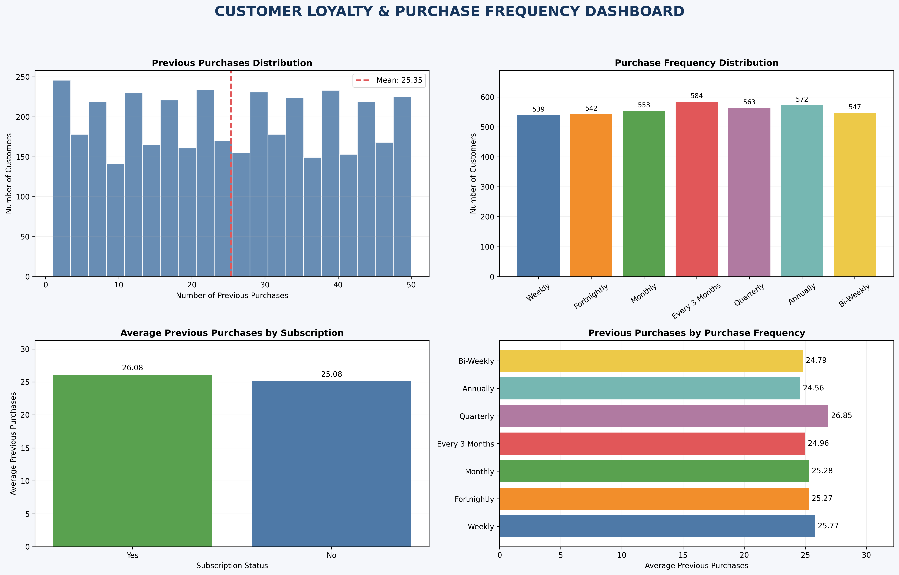
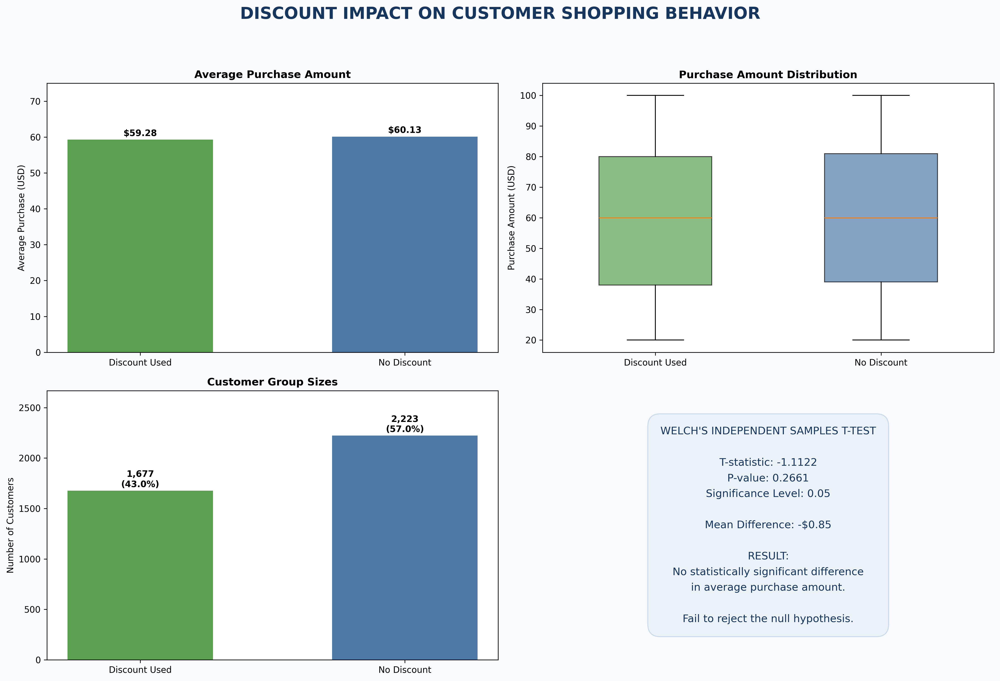
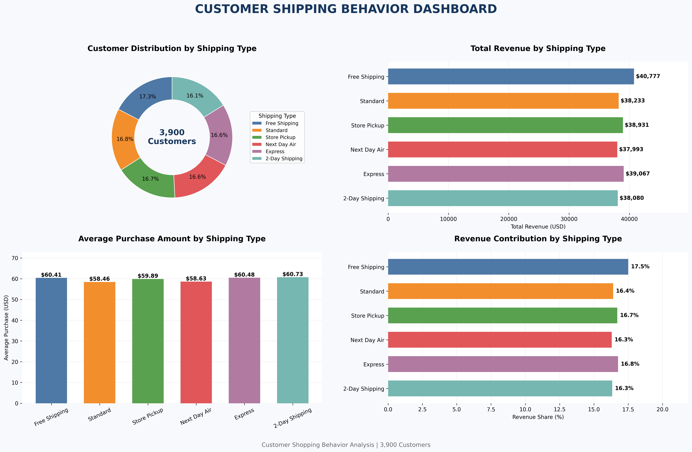
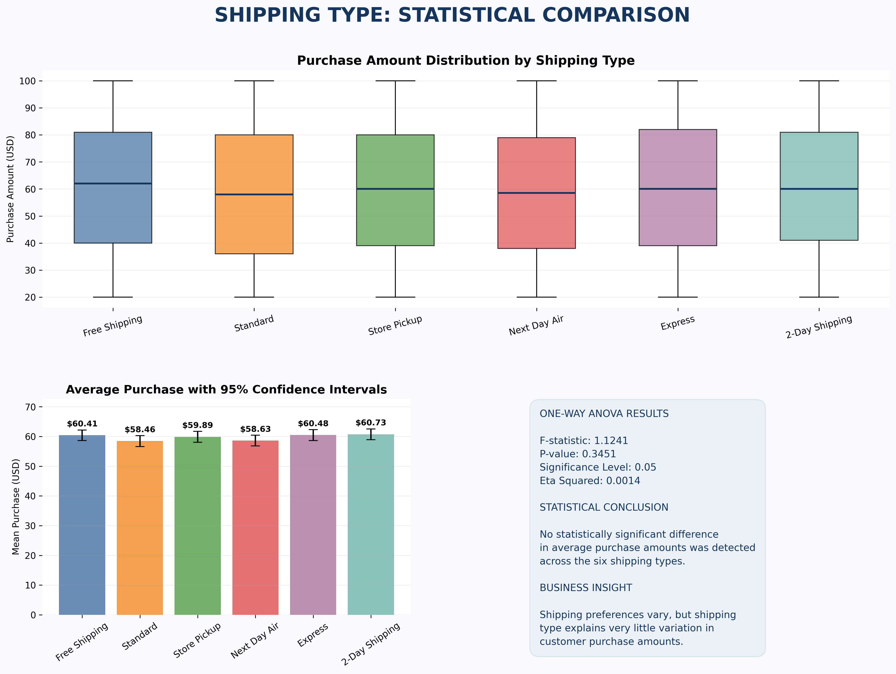

# Customer Shopping Behavior Analysis

### Python | Pandas | Data Visualization | Statistical Analysis | Business Insights

## Project Overview

This project explores customer shopping behavior using a dataset of 3,900 customer purchase records and 18 variables. The goal is to identify purchasing patterns, examine customer segments, and evaluate whether factors such as discounts, shipping preferences, subscription status, and age are associated with customer spending.

The analysis combines exploratory data analysis (EDA), Python visualizations, and statistical hypothesis testing to translate customer data into business insights.

## Project Objectives

- Understand customer demographics and purchasing behavior.
- Compare spending patterns across different age groups.
- Examine customer loyalty, subscription status, and purchase frequency.
- Evaluate the relationship between discount usage and purchase amounts.
- Analyze shipping preferences and revenue contributions.
- Use statistical testing to distinguish observed differences from statistically significant findings.

## Tools and Technologies

- **Python:** Data analysis and statistical computing
- **Pandas:** Data cleaning, grouping, and aggregation
- **NumPy:** Numerical calculations
- **Matplotlib and Seaborn:** Data visualization
- **SciPy:** Hypothesis testing and statistical analysis
- **Google Colab:** Notebook development and execution
- **GitHub:** Project documentation and version control

## Dataset

The dataset contains 3,900 customer shopping records with 18 variables, including:

- Customer demographics: age, gender, and location
- Shopping information: product category and purchase amount
- Customer behavior: previous purchases and purchase frequency
- Shopping preferences: discount usage, subscription status, and shipping type

**Total Records:** 3,900

**Total Purchase Revenue:** $233,081

## Exploratory Data Analysis and Dashboards

### 1. Customer Age Segmentation

The 56+ age group represents the largest customer segment and generates the highest total revenue. However, average spending per purchase remains relatively similar across age groups.

A one-way ANOVA test found no statistically significant difference in average purchase amounts across age groups (p = 0.5651).

### 2. Customer Loyalty and Purchase Frequency

Customers have an average of 25.35 previous purchases.

Subscribed customers average 26.08 previous purchases, compared with 25.08 among non-subscribed customers. However, this difference is not statistically significant at the 5% level (p = 0.0509).

The relationship between previous purchases and current purchase amount is also extremely weak (Pearson r = 0.0081).

### 3. Discount Impact Analysis

Customers who used discounts spent an average of $59.28, compared with $60.13 among customers who did not use discounts.

A Welch's independent-samples t-test found no statistically significant difference (p = 0.2661).

This suggests that discount usage alone does not provide strong evidence of higher spending in this dataset.

### 4. Shipping Behavior Analysis

Shipping preferences are relatively evenly distributed across the six shipping categories.

Free Shipping generates the highest total purchase revenue in the dataset, while average purchase amounts are similar across shipping types.

### 5. Shipping Statistical Comparison

A one-way ANOVA was conducted to compare average purchase amounts across six shipping types.

- **F-statistic:** 1.1241
- **P-value:** 0.3451
- **Significance level:** 0.05
- **Eta squared:** 0.0014

The test found no statistically significant difference in average purchase amounts across shipping categories.

## Key Findings

1. **Customer demographics:** The 56+ segment contributes the most revenue, largely because it contains the largest number of customers.
2. **Customer loyalty:** Subscription status shows a small observed difference in previous purchases, but the evidence does not meet the 5% significance threshold.
3. **Discount effectiveness:** Discount users do not demonstrate statistically significantly higher purchase amounts.
4. **Shipping preferences:** Shipping categories have similar average purchase amounts despite differences in total revenue.
5. **Statistical interpretation:** Observed differences between groups should not automatically be treated as meaningful or causal.

## Business Recommendations

- Develop customer segmentation strategies based on customer population size, purchase patterns, and revenue contribution.
- Evaluate loyalty programs using additional indicators such as customer retention, lifetime value, and repeat purchase rates.
- Measure promotional effectiveness through controlled experiments rather than relying only on comparisons between discount users and non-users.
- Consider shipping costs, delivery preferences, and customer satisfaction when evaluating shipping strategies.
- Combine statistical testing with business context before making marketing or operational decisions.

## Project Files

- `Customer_Shopping_Behavior_Analysis.ipynb` — Complete Python analysis notebook
- `customer_shopping_behavior.csv` — Customer shopping dataset
- Five PNG dashboards — Visual summaries of the analyses
- `README.md` — Project documentation

## How to Run

1. Download or clone this GitHub repository.
2. Open `Customer_Shopping_Behavior_Analysis.ipynb` in Google Colab or Jupyter Notebook.
3. Ensure the required Python libraries are installed.
4. Load `customer_shopping_behavior.csv` using the appropriate file path.
5. Run the notebook cells sequentially to reproduce the analysis.

## Conclusion

This project demonstrates how Python, exploratory data analysis, data visualization, and statistical hypothesis testing can be combined to investigate customer shopping behavior.

Although several customer groups show differences in observed averages and total revenue, the statistical tests highlight the importance of evaluating whether these differences are supported by sufficient evidence.

The project emphasizes data-driven decision-making and the translation of analytical results into practical business recommendations.
